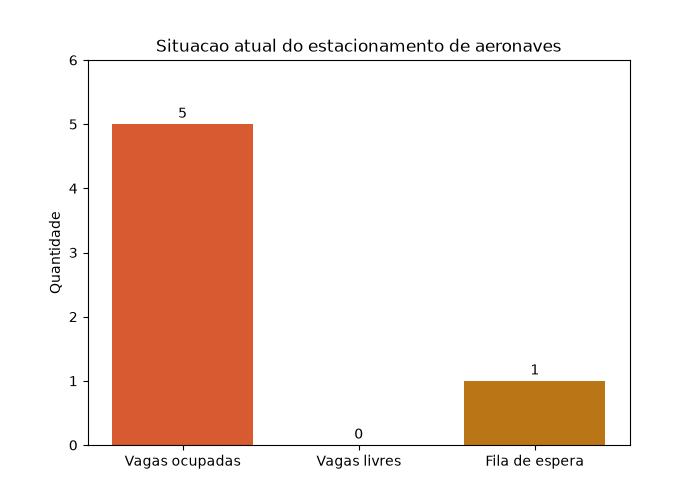

# Estacionamento de aeronaves

Trabalho final da disciplina de Algoritmos (Sistemas de Informação, Antonio Meneghetti Faculdade, 2026). É um sistema de linha de comando em Python que controla o estacionamento de aeronaves de um aeroporto: vagas, fila de espera, cobrança por diária e um gráfico da ocupação.



## O que o sistema faz

- **Solicitar vaga:** o aeroporto tem 5 vagas. Se estiverem todas ocupadas, a aeronave vai para a fila de espera, que tem 1 lugar. Com as vagas e a fila cheias, a aeronave é redirecionada para outro aeroporto. Um código que já está no estacionamento ou na fila é recusado.
- **Retirar aeronave:** calcula os dias estacionados (no mínimo 1) e cobra a diária: R$ 127,00 por dia em estadias de até 29 dias e R$ 115,00 por dia a partir de 30 dias. Quando uma vaga é liberada, a aeronave da fila de espera ocupa essa vaga.
- **Retirar todas as aeronaves:** cobra cada uma e esvazia também a fila de espera.
- **Mostrar aeronaves:** lista as vagas ocupadas, com o código e a data de entrada, e a fila de espera.
- **Adiantar o tempo:** avança o relógio do sistema em dias ou em meses (cada mês conta 30 dias), para simular estadias longas sem esperar.
- **Gráfico:** gera com matplotlib um gráfico de barras com vagas ocupadas, vagas livres e fila de espera, salvo em `grafico_estacionamento.png`.
- **Sair:** mostra o resumo do dia: estacionamentos feitos, retiradas e o valor total em caixa.

## Como rodar

Requisito: Python 3 e a biblioteca matplotlib.

```bash
pip install matplotlib
python Trabalho.py
```

Escolha as opções pelo número do menu. Um teste rápido: estacione 6 aeronaves (a sexta vai para a fila), adiante o tempo em 3 dias, retire a primeira (o valor cobrado é R$ 381,00) e veja a aeronave da fila ocupar a vaga.

## Como foi feito

Trabalho individual, feito com um pouco de auxílio de IA. O programa usa só o que foi visto na disciplina: listas paralelas para os códigos e os horários de entrada, funções para cada operação do menu e laços para buscar e remover aeronaves. As datas usam o módulo `datetime`, e é ele que permite adiantar o tempo e calcular os dias estacionados. O gráfico é a única biblioteca externa.
